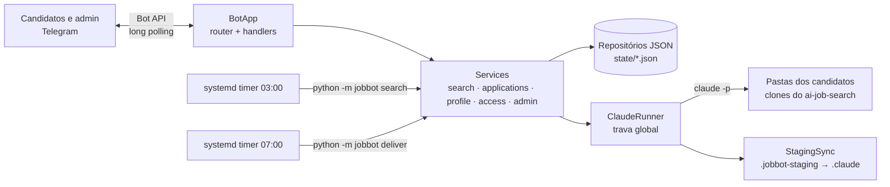

# Arquitetura

## Visão geral



- **BotApp** consome `getUpdates`, entrega cada update ao roteador e coloca o trabalho pesado (tudo o que chama o Claude) numa **fila serial** atendida por um worker. Assim o bot continua respondendo enquanto o Claude trabalha.
- **Services** guardam as regras de negócio e só falam com o mundo por interfaces injetadas (`TelegramClient`, `ClaudeRunner`, repositórios). Nos testes, essas interfaces são trocadas por fakes.
- **Repositórios** gravam JSON com `flock` e escrita atômica, porque o bot e os timers são processos diferentes e mexem nos mesmos arquivos.

## Fluxo diário

```mermaid
sequenceDiagram
    participant T as Timer 03:00
    participant S as SearchService
    participant C as Claude Code
    participant J as JobRepository
    participant D as Timer 07:00
    participant U as Candidato
    T->>S: run()
    loop cada candidato com perfil pronto
        S->>C: /scrape + /rank (prompt de busca)
        C-->>S: .jobbot-shortlist.json (até 5 vagas)
        S->>J: add_new() com status "aguardando"
    end
    S-->>U: (nada ainda; admin recebe resumo silencioso)
    D->>S: deliver_pending()
    S->>J: take_waiting()
    S-->>U: cards com Gerar candidatura / Não tenho interesse
```

A busca manual (`/buscar`) usa o mesmo caminho com `deliver_now=True` e entrega na hora. Se a busca agendada passar das 7h, cada pessoa recebe as vagas assim que a busca dela termina.

## Decisões

| Decisão | Motivo |
|---|---|
| Só biblioteca padrão no runtime | Instalação trivial na VPS, nada para atualizar ou quebrar |
| Um Claude por vez (flock em `claude.lock`) | O limite da assinatura é compartilhado; o bot e os timers usam a mesma trava |
| Staging para `.claude/` | No `claude -p`, a pasta `.claude/` é protegida mesmo com regras de allow; `bypassPermissions` tiraria todas as outras travas |
| Lista permitida no staging | O Claude só consegue alterar arquivos de perfil, nunca `settings.json`, `SKILL.md` ou guardas de segurança |
| Estado em JSON, não em banco | Poucos usuários, poucas escritas, e é fácil de inspecionar e de fazer backup |
| `callback_data` curto (`a:`, `s:`, `d:`, `ok:`, `no:`) | Limite de 64 bytes do Telegram; os botões antigos continuam válidos depois das atualizações |
| Modelos aceitam chaves antigas em PT | O estado da versão anterior migra sozinho, sem script |
